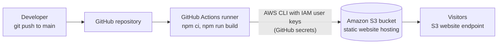
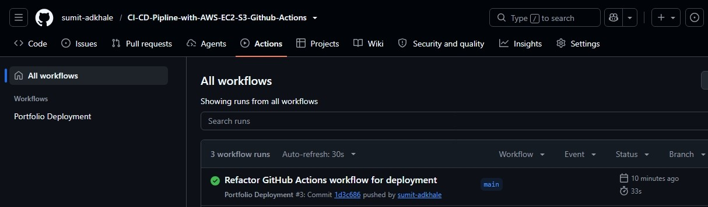
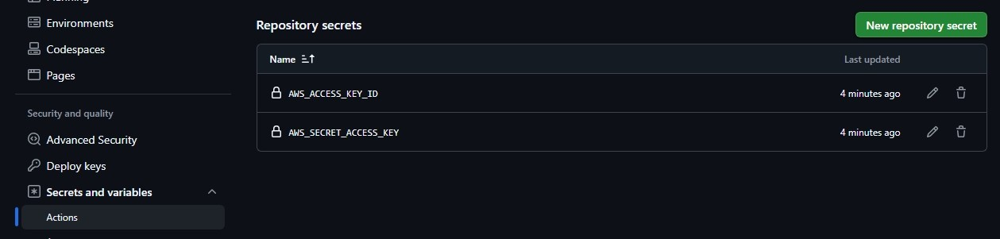
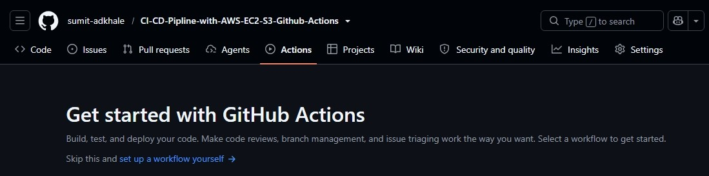
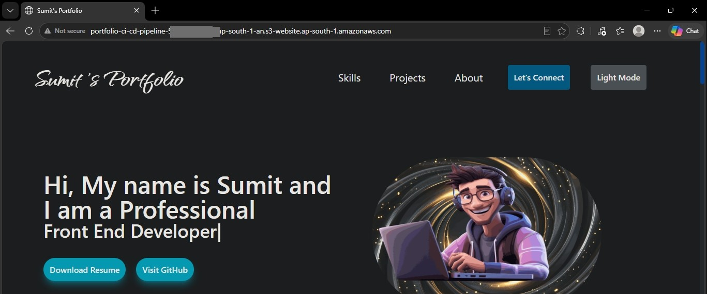
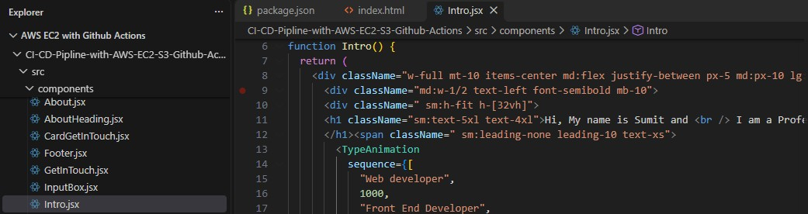
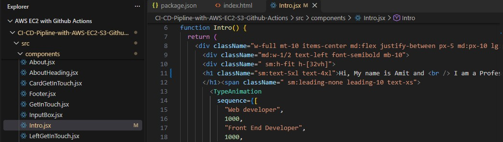
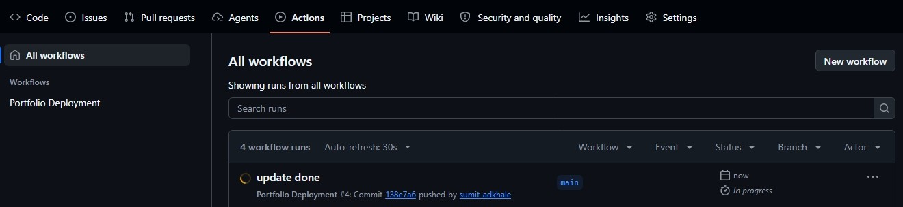

# CI/CD Pipeline with GitHub Actions: React Site to AWS S3

An automated deployment pipeline: every `git push` to `main` makes **GitHub Actions** install dependencies, build a React site, and publish it to an **Amazon S3 static website**, with no manual upload step. The site deployed by the pipeline is my personal portfolio.


## Table of contents
1. [Architecture](#1-architecture)
2. [What it does](#2-what-it-does)
3. [Setup steps](#3-setup-steps)
4. [The workflow file](#4-the-workflow-file)
5. [Testing the pipeline](#5-testing-the-pipeline)
6. [Security notes](#6-security-notes)
7. [Troubleshooting](#7-troubleshooting)
8. [Roadmap](#8-roadmap)
9. [Author](#9-author)

---

## 1. Architecture



| Component | Role |
|---|---|
| **GitHub repository** | Source code for the React site and the workflow file (`.github/workflows/main.yml`) |
| **GitHub Actions** | Runs the pipeline on every push to `main` |
| **GitHub repository secrets** | Store the AWS access key ID and secret access key; they never appear in code or logs |
| **IAM user** | A dedicated deploy user whose policy allows only the S3 actions the pipeline needs |
| **Amazon S3** | Stores the built files and serves them as a static website |

## 2. What it does

On each push to `main`, the workflow runs these steps in order:

1. **Checkout** the code
2. **Set up Node.js 24** with the npm cache
3. **`npm ci`**: clean, reproducible dependency install
4. **`npm run build`**: build the site into `dist/`
5. **Configure AWS credentials** from the repository secrets
6. **Verify identity** with `aws sts get-caller-identity`, so a wrong key fails early with a clear message
7. **`aws s3 sync ./dist s3://<bucket> --delete`**: upload changed files and remove files that no longer exist

A typical run finishes in about 30 seconds.



## 3. Setup steps

### 3.1 Create the S3 bucket and enable static website hosting
1. S3 → **Create bucket** (region `ap-south-1`).
2. Bucket → **Properties** → **Static website hosting** → **Edit** → **Enable**, index document `index.html`.
3. To serve the site publicly over the S3 website endpoint, turn off **Block all public access** for this bucket only, and add a read-only bucket policy (replace the bucket name):

```json
{
  "Version": "2012-10-17",
  "Statement": [{
    "Sid": "PublicReadGetObject",
    "Effect": "Allow",
    "Principal": "*",
    "Action": "s3:GetObject",
    "Resource": "arn:aws:s3:::YOUR_BUCKET_NAME/*"
  }]
}
```

The bucket holds only public website files. Never put anything private in it.

### 3.2 Create a least-privilege IAM user for deployments
1. IAM → **Users** → **Create user** (no console access).
2. Attach this inline policy, which lets the pipeline list the bucket, upload files and delete stale ones, and nothing else:

```json
{
  "Version": "2012-10-17",
  "Statement": [
    { "Effect": "Allow", "Action": "s3:ListBucket",
      "Resource": "arn:aws:s3:::YOUR_BUCKET_NAME" },
    { "Effect": "Allow", "Action": ["s3:PutObject", "s3:DeleteObject"],
      "Resource": "arn:aws:s3:::YOUR_BUCKET_NAME/*" }
  ]
}
```
3. User → **Security credentials** → **Create access key** → use case **Command Line Interface** → copy the key ID and secret once.

### 3.3 Push the code to GitHub
```bash
git init
git add .
git commit -m "Initial commit"
git branch -M main
git remote add origin https://github.com/<your-username>/<repo>.git
git push -u origin main
```

### 3.4 Add the credentials as GitHub secrets
Repository → **Settings** → **Secrets and variables** → **Actions** → **New repository secret**. Create two secrets with these exact names:

| Name | Value |
|---|---|
| `AWS_ACCESS_KEY_ID` | the access key ID |
| `AWS_SECRET_ACCESS_KEY` | the secret access key |



### 3.5 Add the workflow
Create `.github/workflows/main.yml` (full file below) and change `S3_BUCKET` to your bucket name. Commit it, and the first run starts automatically. You can watch it under the **Actions** tab.



### 3.6 Open the website
S3 bucket → **Properties** → **Static website hosting** → click the **Bucket website endpoint**.



## 4. The workflow file

```yaml
name: Portfolio Deployment

on:
  push:
    branches:
      - main

permissions:
  contents: read

env:
  AWS_REGION: ap-south-1
  S3_BUCKET: YOUR_BUCKET_NAME        # replace with your bucket name

jobs:
  build-and-deploy:
    runs-on: ubuntu-latest
    steps:
      - name: Checkout
        uses: actions/checkout@v4

      - name: Set up Node.js
        uses: actions/setup-node@v4
        with:
          node-version: 24
          cache: npm

      - name: Install packages
        run: npm ci

      - name: Build website
        run: npm run build

      - name: Configure AWS credentials
        uses: aws-actions/configure-aws-credentials@v6
        with:
          aws-access-key-id: ${{ secrets.AWS_ACCESS_KEY_ID }}
          aws-secret-access-key: ${{ secrets.AWS_SECRET_ACCESS_KEY }}
          aws-region: ${{ env.AWS_REGION }}

      - name: Verify AWS identity
        run: aws sts get-caller-identity

      - name: Deploy static site to S3
        run: aws s3 sync ./dist s3://${{ env.S3_BUCKET }} --delete --region ${{ env.AWS_REGION }}
```

`permissions: contents: read` gives the workflow's built-in token read-only access to the repository, the minimum it needs.

## 5. Testing the pipeline

I changed the greeting text in `src/components/Intro.jsx`, committed, pushed, and watched the pipeline deploy it.

**Before** (original code) and **after** (edited line, shown as modified in the editor):




**Pushing starts a new workflow run automatically:**

```bash
git add .
git commit -m "update greeting"
git push origin main
```



**After the run turns green, a browser refresh shows the change live:**


## 6. Security notes

| Topic | Current state |
|---|---|
| Credentials | Stored as encrypted GitHub secrets, never in the code or the workflow file; GitHub masks them in logs |
| IAM permissions | A dedicated user limited to listing, uploading and deleting objects in one bucket |
| Workflow token | `contents: read` only |
| Bucket | Public read of website files only; no private data |
| **Limitation** | The IAM user has **long-lived access keys**. If they leak they work until revoked. The recommended replacement is OpenID Connect (see the roadmap). |
| **Limitation** | The S3 website endpoint serves **HTTP only**, with no CDN. CloudFront gives HTTPS and caching. |

If a key is ever exposed, deactivate and delete it immediately in IAM → Users → Security credentials, then create a new one and update the GitHub secrets.

## 7. Troubleshooting

| Symptom | Likely cause and fix |
|---|---|
| `Could not load credentials` or `The security token included in the request is invalid` | The secret names must be exactly `AWS_ACCESS_KEY_ID` and `AWS_SECRET_ACCESS_KEY`, with no extra spaces. Re-create them if unsure. |
| `AccessDenied` during `s3 sync` | The IAM policy bucket name is wrong, or the policy lacks `ListBucket`, `PutObject` or `DeleteObject` |
| `NoSuchBucket` | Typo in `S3_BUCKET`, or the bucket is in another region |
| `npm ci` fails | `package-lock.json` is missing or out of sync with `package.json`. Run `npm install` locally and commit the lock file. |
| `./dist` not found | The build outputs to another folder. Check the build tool's output directory and change the sync path. |
| Website shows `403 Forbidden` | Static website hosting is off, Block Public Access is still on, or the bucket policy is missing |
| Old content after a deploy | The browser is caching. Hard-refresh (Ctrl+Shift+R). |

## 8. Roadmap

Planned improvements, in priority order:

1. **Replace stored access keys with GitHub OIDC.** The workflow assumes a short-lived IAM role, so no keys are stored anywhere:
   ```yaml
   permissions:
     id-token: write
     contents: read
   # ...
   - uses: aws-actions/configure-aws-credentials@v6
     with:
       role-to-assume: arn:aws:iam::ACCOUNT_ID:role/github-actions-deploy
       aws-region: ap-south-1
   ```
   The role's trust policy allows `token.actions.githubusercontent.com` and is restricted to this repository and the `main` branch.
2. **Put CloudFront in front of S3** with Origin Access Control (a private bucket, HTTPS) and add a `aws cloudfront create-invalidation` step after the sync.
3. **Add quality gates:** lint and tests on pull requests, with the deploy job running only on `main`.
4. **Separate staging and production** environments with manual approval for production.
5. **Define the infrastructure as code** (Terraform) so the bucket, IAM and OIDC role can be recreated in one command.

## 9. Author

**Sumit**: IT Infrastructure and Cloud (AWS)
[GitHub](https://github.com/sumit-adkhale) · [LinkedIn](https://linkedin.com/in/sumit-adkhale/)
